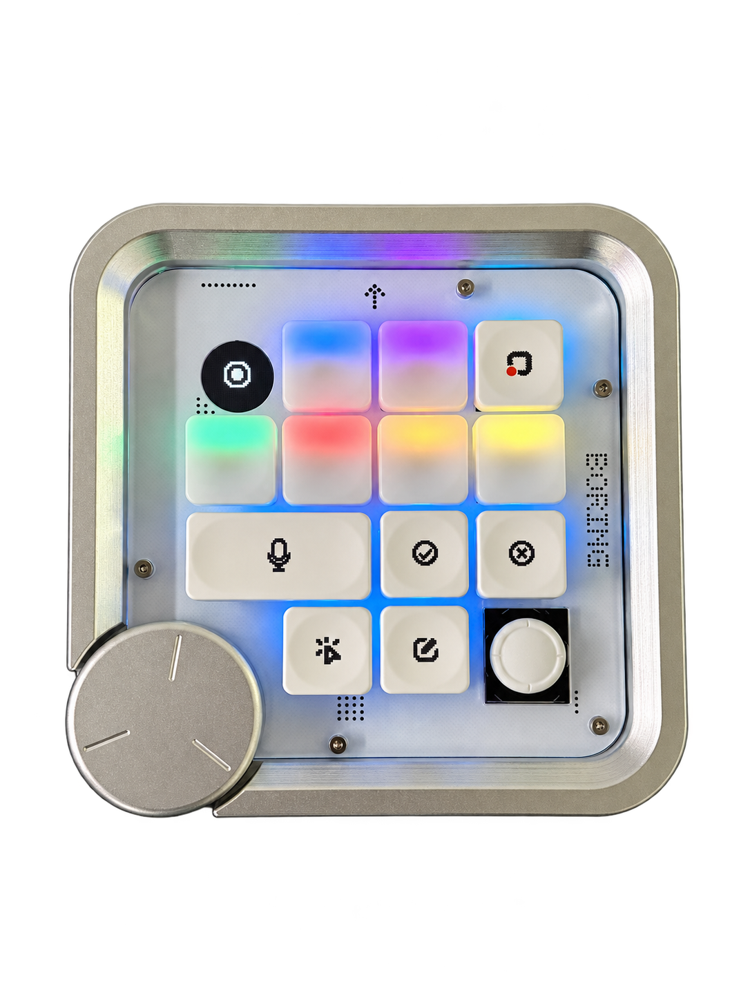

# BORING Developer Kit

让用户通过扩展、设备协议、控制台与固件源码，定义自己的 BORING 使用方式。

**MIST 需要恢复或重新校准？** [下载 20261118.01 固件更新与校准工具（Apple 芯片 Mac / Windows 64 位）](https://github.com/JoeySystem/boring-developer-kit/releases/tag/mist-recovery-20261118.01) · [使用说明](recovery-tool/README.md) · [交给 AI 的提示词](recovery-tool/AI-RECOVERY-PROMPT.md)。工具会写入官方签名固件、**清空三个蓝牙槽位**（之后需重新配对）、把出厂 Profile 的第 8 键设为单击说话双击发送，并重新校准摇杆。工具内置固件是 20261118.01，之后可在 Console 里升到 20261123.01。需要设备能正常开机并响应 USB 通信，不能替代硬件维修。

**固件源码已公开：[编译入口](firmware/README.md) · [DIY 可改、慎改与禁止改动范围](firmware/DIY-GUIDE.md) · [维护包格式与导入条件](firmware/PACKAGE-FORMAT.md)。USB、认证、更新、启动、分区、电源和存储底层坚决不要改。只有设备仍可正常连接、认证和更新时，才具备控制台恢复官方固件的前提。**

**公开源码已同步：控制台 0.3.0、Power V2 固件 20261123.01、SDK 1.1.0 / API 1.1。**

- **下载源码开发包：**[v0.1.0-preview.11](https://github.com/JoeySystem/boring-developer-kit/releases/tag/v0.1.0-preview.11)，含控制台、固件、SDK、四个扩展示例和协议资料。
- **官方安装包：**[Console 0.3.0（macOS Apple Silicon / Windows x64）](https://github.com/JoeySystem/boring-developer-kit/releases/tag/console-v0.3.0)，已装旧版的电脑会在软件内收到更新；说明见[安装说明](docs/install-console.md)。开发者套件不再附安装包。
- **固件：**公开源码对应[官方签名固件 20261123.01](docs/official-firmware-20261123.01.md)（样机权威包，sample-verified，已上官网更新源 sample 渠道）；[20261012.01](docs/official-firmware-20261012.01.md) 与 [20260916.01](docs/official-firmware-20260916.01.md) 历史维护包保留在原 Release。

社区构建使用独立设置、系统字体和简化设备示意，不附内部品牌模型或演示动画，也不订阅官方自动更新。原创内容采用 **PolyForm Noncommercial 1.0.0**，商业复用需另行授权。

[开始使用](START-HERE.md) · [源码说明](docs/console-source.md) · [本次验证](docs/verification-sync-20261124.md) · [许可](LICENSING.md)

  
   
  BORING MIST · 产品实拍

## 本次可用的内容

| 内容 | 入口 |
|---|---|
| 固件源码、编译与 DIY 边界 | [firmware](firmware/README.md) · [修改与恢复说明](firmware/DIY-GUIDE.md) |
| 控制台源码、运行与构建 | [console](console/README.md) · [来源与边界](docs/console-source.md) |
| 固件更新与校准工具源码（Mac / Windows） | [recovery-tool](recovery-tool/README.md) · [故障排查](recovery-tool/TROUBLESHOOTING.md) |
| Python SDK 源码及安装说明 | [sdk/python](sdk/python/README.md) |
| 四个扩展及预期结果 | [示例说明](examples/README.md) |
| SDK 方法、返回值和错误处理 | [API 参考](docs/api.md) |
| 扩展 manifest、动作和提案 | [扩展接口](docs/extensions.md) |
| 设备事件字段 | [设备事件](docs/device-events.md) |
| USB / BLE WMP1 协议、配置 Schema 和公开测试向量 | [protocol](protocol/README.md) |
| 平台与配套控制台限制 | [兼容说明](docs/versions.md) |
| 修改、导入和重新打包自己的扩展 | [开发流程](docs/development-guide.md) |

## 运行前先确认宿主

SDK 是控制台本地 API 的客户端，**不是独立硬件驱动**。运行扩展需要具有扩展 Runner / API 1.0 的 BORING Console，以及控制台接受的设备会话。

控制台公开源码参考 0.3.0 的已发布代码，使用社区构建身份。运行和构建见 [控制台说明](console/README.md)。源码测试与模拟设备验证不等同于 Windows 安装、实体按键或固件刷写验收。

SDK/API 1.1 增加电脑端任务事件，兼容 1.0 提示词槽位、绑定动作与确认式映射提案；不开放任意原始输入流或生产身份签发。见 [接口说明](docs/extensions.md)。

## 下载与维护

源码开发包、SDK 和扩展在 [preview.11 Release](https://github.com/JoeySystem/boring-developer-kit/releases/tag/v0.1.0-preview.11)；官方签名固件 20261123.01 与完整固件包在[固件 Release](https://github.com/JoeySystem/boring-developer-kit/releases/tag/firmware-20261123.01)；固件更新与校准工具在[工具 Release](https://github.com/JoeySystem/boring-developer-kit/releases/tag/mist-recovery-20261118.01)；Console 安装包在 [console-v0.3.0](https://github.com/JoeySystem/boring-developer-kit/releases/tag/console-v0.3.0)。历史版本保留在原有 Release。GitHub 的 **Code → Download ZIP** 是仓库源码快照，不可直接当固件维护包导入。

包括本轮控制台代码在内的原创内容采用 **PolyForm Noncommercial 1.0.0**，商业复用另行书面授权。保留 NOTICE 与第三方许可，具体范围见 [LICENSING](LICENSING.md)。

按 [Best Effort](SUPPORT.md) 维护，不承诺固定响应、合并或发布周期。问题和需求请使用 [Issue 入口](https://github.com/JoeySystem/boring-developer-kit/issues/new/choose)，贡献方式见 [CONTRIBUTING](CONTRIBUTING.md)，版本变化见 [CHANGELOG](CHANGELOG.md)。
